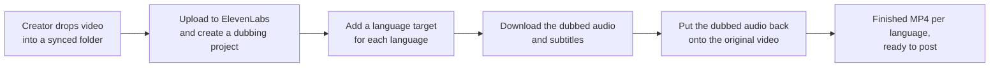

# Creator Dubbing Pipeline

**Turn one creator video into ready-to-post versions in other languages, automatically, using the ElevenLabs Dubbing API.**

Millions of bilingual creators post almost entirely in English, even though a large share of their potential audience prefers another language. Running a second channel in Spanish, Portuguese or Hindi usually means re-recording or hiring a dubbing team, so most creators never do it.

This pipeline removes that work. A creator drops a finished video into a folder. The pipeline dubs it in the creator's own voice and delivers a finished MP4 for each language, ready to post to a dedicated TikTok, YouTube Shorts or Instagram account.

> **Status:** early prototype, built on the current ElevenLabs Dubbing API and now in testing with real creator videos. Automated posting to social platforms is on the roadmap.

## How it works



1. **Upload.** The original video goes to ElevenLabs as a new dubbing project.
2. **Translate and dub.** ElevenLabs transcribes the video, translates it and voices it in each target language, keeping the creator's voice.
3. **Download.** The pipeline waits for each language to finish, then downloads the dubbed audio track and subtitle file.
4. **Assemble.** ffmpeg replaces the original audio with the dubbed audio, so the video quality is untouched.
5. **Deliver.** Each language comes out as its own MP4 in the output folder, for example `myvideo_es.mp4`.

## Quick start

**You'll need:** Python 3.10 or newer, [ffmpeg](https://ffmpeg.org), and an [ElevenLabs](https://elevenlabs.io) API key.

```bash
git clone https://github.com/TheJackYoung/creator-dubbing-pipeline.git
cd creator-dubbing-pipeline
pip install -r requirements.txt
export ELEVENLABS_API_KEY=your_key_here
```

**Dub a single video into Spanish:**

```bash
python dub.py myvideo.mp4 --languages es
```

**Dub into several languages at once:**

```bash
python dub.py myvideo.mp4 --languages es pt hi --out output
```

**Watch a folder.** Point it at a Google Drive folder synced to your computer. Every new video dropped in is dubbed automatically, then moved to a `done` subfolder:

```bash
python dub.py --watch "~/Google Drive/Dubbing/Inbox" --languages es
```

## What you get

For each language, the output folder contains:

| File | What it is |
| --- | --- |
| `myvideo_es.mp4` | The finished video with Spanish audio, ready to post |
| `myvideo_es.flac` | The dubbed audio track on its own |
| `myvideo_es.vtt` | Subtitles in that language, for captions |

## Who it's for

- **Bilingual creators** who want a second-language channel without re-recording every video
- **Creator managers and agencies** running localized accounts for their roster
- **Brands** that want creator content to reach audiences in more than one language

## Roadmap

- [ ] Dub a video into one or more languages in the creator's voice
- [ ] Rebuild a finished, ready-to-post MP4 per language
- [ ] Watch a synced folder for hands-off processing
- [ ] Run directly from Google Drive in the cloud, with no computer left on
- [ ] Schedule and post to TikTok, YouTube Shorts and Instagram
- [ ] Review step so the creator can approve each dub before it goes live
- [ ] Per-creator dashboard showing views and growth on each language account

## Notes

- Dubbing uses ElevenLabs credits. Each extra language is billed separately. See [ElevenLabs pricing](https://elevenlabs.io/pricing).
- Only dub content you own or have the creator's permission to dub. Use the creator's voice only with their consent.
- Your API key stays on your machine. It is read from the `ELEVENLABS_API_KEY` environment variable and never stored in the code.

## About

Built by **Jack Young**, Head of Creator at Greenwood Management, a creator management company in Los Angeles. I've spent 13+ years working with creators, and this project comes from a real gap I see on my roster: great content that never reaches the audiences who would love it, just because of language.

[LinkedIn](https://www.linkedin.com/in/jack-young-88454253/) · Jack@greenwoodmgmt.com
